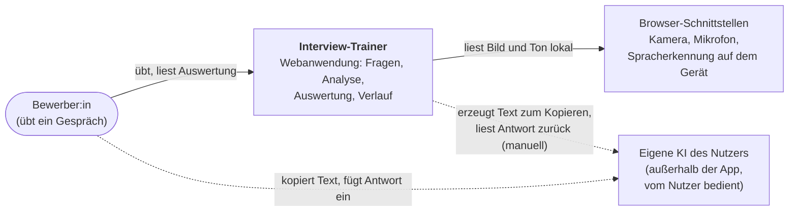
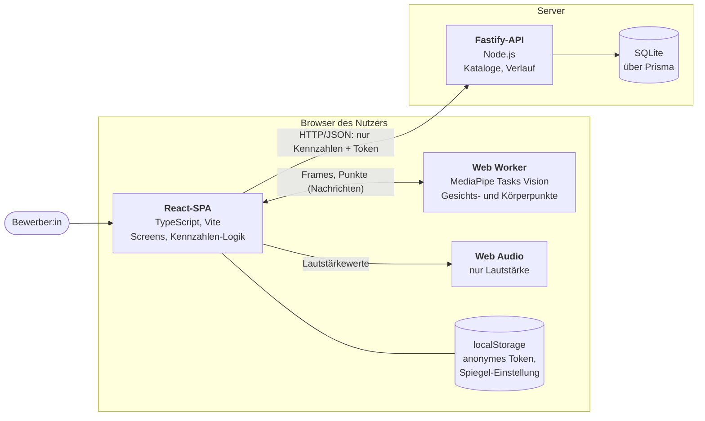
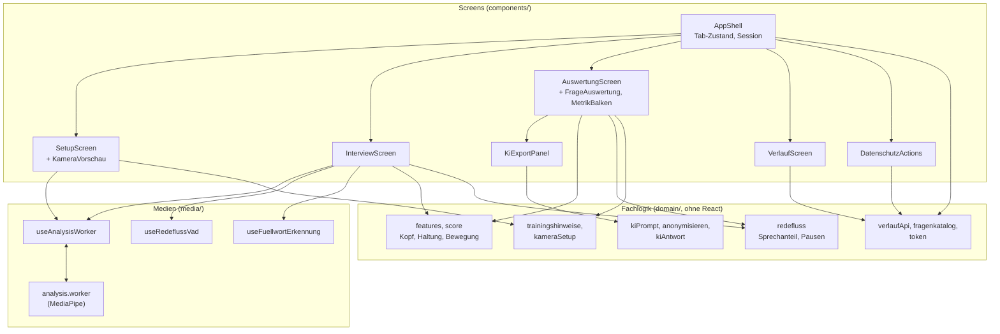
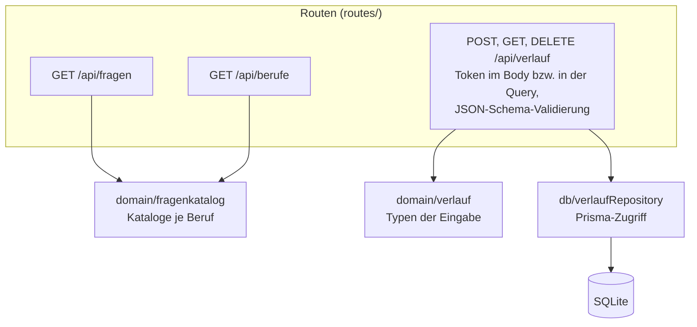
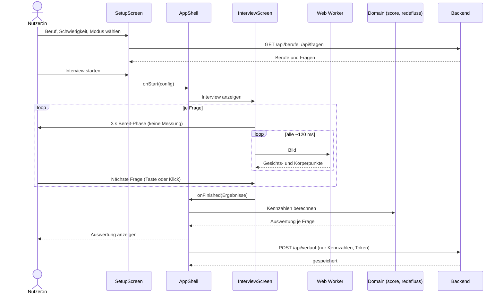
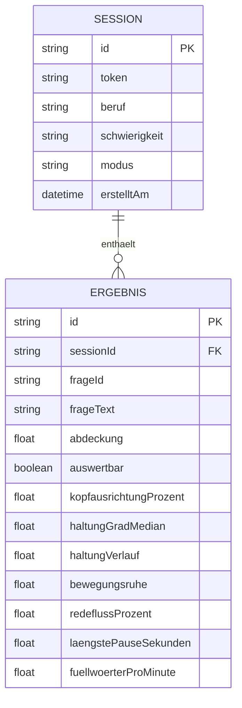

# Architektur des Interview-Trainers

Softwarearchitektur im C4-Stil (Kontext, Container, Komponenten) und als UML (Sequenz, Datenmodell). Die Diagramme sind Mermaid und werden von GitHub direkt gerendert. Sie beschreiben den Stand der Implementierung; Begründungen stehen in `docs/decisions/` (ADR-0001 bis ADR-0011).

## Ebene 1: Systemkontext

Wer nutzt das System, und womit hängt es zusammen?

Die Anwendung ruft **kein** Sprachmodell auf (ADR-0001). Die gestrichelten Linien sind Handlungen der Nutzer:in außerhalb der App (ADR-0011).

## Ebene 2: Container

Welche ausführbaren Bausteine gibt es, und was fließt zwischen ihnen?

Video und Ton verlassen den Browser nie; zum Server gehen nur aggregierte Kennzahlen und ein zufälliges Token (ADR-0002, ADR-0006).

## Ebene 3: Komponenten

### Frontend (React-SPA)

Die Fachlogik (`domain/`) kennt weder React noch den Browser und ist deshalb test-first mit synthetischen Daten entwickelt (ADR-0005).

### Backend (Fastify)

## UML: Ablauf einer Übungssession

## UML: Datenmodell

Löschen einer Session löscht ihre Ergebnisse mit (`onDelete: Cascade`). Es gibt kein Feld für Video, Audio oder Transkript.

## Zuordnung zu den Entscheidungen

| Thema | ADR |
|---|---|
| Regelbasiert statt LLM zur Laufzeit | 0001 |
| Datenschutz: Analyse im Browser | 0002 |
| Vorgehensmodell | 0003 |
| Web Worker für die Bildanalyse | 0004 |
| Scoring-Kernlogik | 0005 |
| Verlauf und anonymes Token | 0006 |
| Integrationstest statt Playwright | 0007 |
| Redefluss | 0008 |
| Kameravorschau und Bereit-Phase | 0009 |
| Berufsauswahl und Kataloge | 0010 |
| KI-Export | 0011 |
